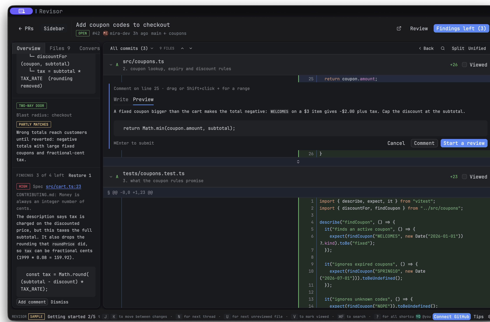
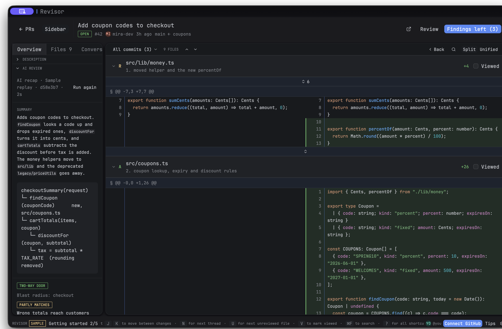

<p align="center"></p>

<h1 align="center">Revisor</h1>

<p align="center"><b>AI code review that lands on the diff.</b><br>
Native GitHub PR review. Click once: Claude Code or Codex reviews the PR, and each finding shows on its line.</p>

## Why Revisor

AI can review a pull request in seconds. The slow part comes after that: the review is in a terminal or a chat, and the code is on GitHub. You find each line again and type each comment again. Review bots remove that work, but they put each comment directly on the PR, and the team learns to ignore them.

Revisor puts the AI review, the diff, and your GitHub review in one window. You decide what the author sees.

| The pain | With Revisor |
|---|---|
| You copy AI findings from a terminal to GitHub by hand | Each finding is on its code line. Click **Add comment** to make it a draft comment, or **Dismiss** to drop it. |
| A bot floods the PR with comments that nobody approved | Nothing goes to GitHub until you post it. You can edit each comment first. |
| You open a large PR and do not know where to start | Read the recap first: summary, evidence, and merge danger. Then at most 10 comments, the most severe first. |
| One PR mixes many changes, and the file list does not show which files go together | The AI puts the changed files into logical groups. Click a group or a file to see only that part of the diff. |
| Each AI review tool wants a new account, API key, and bill | Revisor runs the Claude Code or Codex CLI that you already have. No Revisor account. |
| The GitHub page is slow on large diffs, and you lose your place | A native app with keyboard navigation. Large diffs load on demand, and viewed files stay marked. |

**Try it in one minute.** The app has an offline sample pull request with a recorded AI review. You need no GitHub account and no AI CLI.

## In the app

These images use the offline sample pull request. No GitHub account is needed to try it.

**Turn an AI finding into a comment on the code line:**



**Read the AI recap beside the diff:**



## Download

Get the latest version from [Releases](https://github.com/Selnapenek/revisor/releases/latest):

| System | File |
|---|---|
| macOS 11 or later (Apple Silicon and Intel) | `Revisor-<version>-macos-universal.dmg`. See [first start on macOS](#share-with-macos-users) |
| Windows 10 or later (x64) | `Revisor-<version>-x64-setup.exe` |
| Ubuntu 22.04+, Debian 12+ | `revisor_<version>_amd64.deb` or `revisor_<version>_arm64.deb`: `sudo apt install ./revisor_<version>_amd64.deb` |
| Fedora 43 or later | `revisor-<version>-1.fc43.x86_64.rpm` or `.aarch64.rpm` |
| Arch, CachyOS (x86_64) | `revisor-<version>-1-x86_64.pkg.tar.zst` |

Revisor updates itself after that. Each file has a [minisign](https://jedisct1.github.io/minisign/) signature (`.sig`), and `SHA256SUMS` lists the checksums. To check a download by hand:

```sh
minisign -Vm Revisor-<version>-macos-universal.dmg -x Revisor-<version>-macos-universal.dmg.sig \
    -P RWRH6ecO2uiUJbm3paeo2D3jtdAFZfLOxFJeVqSilGnU/woiHLacKkid
```

Windows shows a SmartScreen warning because the installer has no code signing certificate. Click **More info**, then **Run anyway**.

## Getting started

No account needed: click **Try a sample pull request** on the sign-in screen. See [Getting started](docs/getting-started.md).

## Roadmap

See the [product roadmap](docs/roadmap.md) for current priorities, progress, release criteria, and the next task.

## Run

Native app built with [gpui-kit](https://gpui-kit.com):

```sh
cargo run -p revisor-app
```

Tests: `cargo test -p revisor-core`.

## Release

Push a version tag to build and publish the macOS, Fedora, and Arch packages. Installed apps offer the update. See [Releasing](docs/releasing.md).

## Share with macOS users

```sh
./scripts/package-macos.sh
```

This makes `target/dist/Revisor-<version>-macos-universal.dmg` for Apple Silicon and Intel Macs (macOS 11 or later), and the in-app update package. Send the DMG.
The package uses an ad hoc signature and needs no signing certificate. If you have a Developer ID Application certificate, set `REVISOR_SIGNING_IDENTITY` to its name or SHA-1 hash to use it instead.

The app has no Apple notarization, so macOS can block the first start. Tell users to do these steps one time:

1. Open the DMG and drag **Revisor** to **Applications**.
2. Open Revisor. macOS shows a warning. Click **Done**.
3. Open **System Settings > Privacy & Security**. Below **Security**, click **Open Anyway** and enter your password.

Or run `xattr -dr com.apple.quarantine /Applications/Revisor.app` in Terminal. The DMG has these steps in **If Revisor does not open.txt**. Updates from inside Revisor do not show the warning again.

## Share with Fedora users

On macOS, install Docker and run:

```sh
./scripts/package-fedora.sh
```

This builds an x86_64 RPM in a Fedora 43 container and puts it in `target/dist/`.
Send `target/dist/revisor-<version>-1.fc43.x86_64.rpm` to Fedora 43 or later users with x86_64 PCs.
They can install it with `sudo dnf install ./revisor-<version>-1.fc43.x86_64.rpm`, then start **Revisor** from the app menu.
The app needs a graphical Wayland or X11 session and a working Vulkan driver. To build again, Docker keeps the Rust download and build files under `target/`.
The RPM has no package signature.

## Share with CachyOS users

On macOS, install Docker and run:

```sh
./scripts/package-arch.sh
```

This builds an x86_64 Arch package in a container and puts it in `target/dist/`.
Install it on CachyOS with `sudo pacman -U ./target/dist/revisor-<version>-1-x86_64.pkg.tar.zst`, then start **Revisor** from the app menu. The app needs a graphical Wayland or X11 session and a working Vulkan driver. In-app updates use `pkexec pacman -U`; install `polkit` if it is not on the system. The package has no package signature.

## GitHub sign-in

Revisor uses GitHub OAuth device flow. See [GitHub OAuth setup](docs/github-oauth.md) to register the OAuth app and set `REVISOR_GITHUB_CLIENT_ID` in `.env`. The client ID is baked in at build time.

To stay signed in without a Revisor Keychain prompt, sign in to [GitHub CLI](https://cli.github.com/manual/gh_auth_login) with `gh auth login`, then select **Use GitHub CLI (stay signed in)** in Revisor. Revisor asks `gh` for its current token when the app starts. OAuth sign-in, pasted tokens, and the optional TypeSafe key last only until Revisor closes. Revisor no longer reads or writes its own Keychain items.

## License

[FSL-1.1-MIT](LICENSE.md) (Functional Source License). You can use, change, and share Revisor for any purpose except a competing commercial product. Each version becomes MIT two years after its release.
